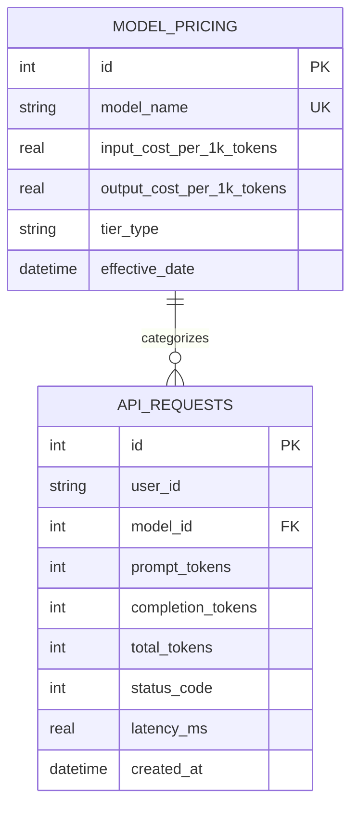

# System Architecture & Design Documentation

## Overview
LLM Cost Analytics is an enterprise-grade analytics engine and relational schema tailored for tracking LLM token consumption, calculating tiered pricing models, detecting sudden cost spikes, and generating aggregated utilization telemetry.

## Entity-Relationship Architecture

## Schema Details
- **`model_pricing`**: Defines billing tiers per 1,000 prompt and completion tokens.
- **`api_requests`**: Stores request-level telemetry linked to model configurations with cascading referential integrity.
- **Indexes**: Composite and single-column indexes on `user_id`, `model_id`, and `created_at` ensure sub-millisecond query performance on large datasets.
